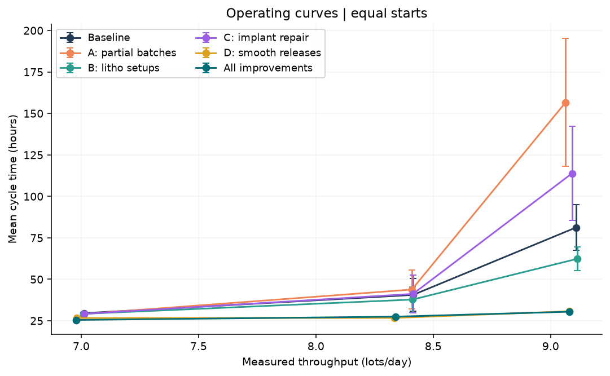

# Mini-Fab cycle time variability

How the timing of new orders affects the time a batch of wafers spends in a semiconductor factory.

Author: Shawn ([shawnslee1202](https://github.com/shawnslee1202))

Each curve shows what happens as more lots enter the simulated factory. Policies at the same load receive the same average number of starts per day.

## What this is

A lot is a group of wafers that moves through the factory together. Each lot visits some machines twice and may wait for other lots before a furnace can start. Using processing times from published Mini-Fab studies, the simulation compares four changes: starting a furnace before it fills, shortening machine changeovers, speeding up repairs and spacing new arrivals evenly. The study used 960 runs to compare policies and 7,245 further runs to narrow uncertainty in their estimated average times.

## Results at a glance

| Finding | Measured result |
|---|---|
| Evenly spaced arrivals saved time at 85% nominal load and the same average arrival rate. | [39.10 hours per lot fell to 26.72 hours, a saving of 12.38 hours.](docs/FINDINGS.md) |
| No policy met the illustrative 24-hour target at that load. | [The lowest tested mean was 25.23 hours per lot.](docs/FINDINGS.md) |
| Starting a partially filled furnace could increase waiting elsewhere. | [At 85% load, this change alone raised the original comparison mean from 40.56 to 43.80 hours per lot.](docs/FINDINGS.md) |
| All 96 estimates met the precision target over the simulated periods. | [The largest 95% confidence interval extended 4.87% of the mean on either side.](results/final_precision.csv) |
| The simulation failed to reproduce the published factory benchmark. | [With random arrivals averaging 120 minutes apart, measured cycle time was 13,554 minutes per lot versus 1,813 minutes published.](docs/BENCHMARK.md) |

## Quick start

From the repository root, use Python 3.12 in an activated virtual environment.

~~~sh
python -m pip install -r requirements.txt
python -m unittest discover -s tests
~~~

## Reproduce

Rebuild the [two-page report](reports/report.pdf) from the included summaries and figures:

~~~sh
python -m minifab_cycle_time_variability.reporting.make_report
~~~

The report takes seconds once dependencies are installed and requires no credentials. The [full run sequence](docs/OPERATIONS.md) starts with calibration and takes several hours. The [versioned study download](https://github.com/shawnslee1202/minifab-cycle-time-variability/releases/tag/v1.0.0) includes run-level results and a sample database. Its scripts use the original layout.

## Repository map

| Directory | Contents |
|---|---|
| [minifab_cycle_time_variability/](minifab_cycle_time_variability/) | Simulation model, experiment runners, analysis, validation and reporting |
| [tests/](tests/) | Checks for machine use, routing, batch rules and time accounting |
| [results/](results/) and [figures/](figures/) | Summary tables and charts |
| [reports/](reports/) and [docs/](docs/) | Report, findings, methods and benchmark comparisons |
| [notebooks/](notebooks/) | Analysis notebook |
| [dashboard/](dashboard/dist/) and [tableau/](tableau/) | Offline HTML dashboard and packaged Tableau workbook |

## Limitations

- The main experiment follows one product through six processing steps. [Model](docs/MODEL.md)
- Precise estimates over a fixed period can coexist with growing queues over longer periods. [Ten-year check](docs/FINDINGS.md)
- The 24-hour target and the costs of the changes are illustrative. [Assumptions](docs/OPERATIONS.md)
- Differences from the published benchmark limit the use of these estimates for factory forecasts. [Benchmark comparison](docs/BENCHMARK.md)

## Sources and attribution

The result tables contain simulated data. The model uses Mini-Fab parameters reported by El-Khouly and Wang, operator assignments discussed by McGinnis, and published queueing formulas. [Sources and parameter choices](docs/MODEL.md)

The repository has no stated project license. Referenced publications and software dependencies retain their own terms.
