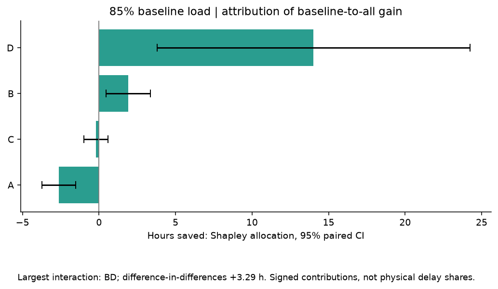

# Mini-Fab cycle-time variability study





**85% equal starts:** baseline 40.56 h; smooth starts 26.72 h; best tested BCD 25.23 h. The illustrative 24-hour target is infeasible among the tested combinations.


**External benchmark failed.** Published throughput and cycle time do not jointly match the reference runs. See [the comparison and capacity calculation](BENCHMARK.md). Source parameters place setups at lithography and random repairs at implant.


96/96 cell means meet the 5% precision criterion for the measured horizon (maximum relative half-width 4.87%). The balanced factorial uses 960 runs. Two fixed confirmation stages add 6,989 and 256 runs. The [final estimates](results/final_precision.csv) give the confidence interval and sampling stage for each case. At 85% equal starts the confirmed baseline is 39.10 hours, compared with 26.72 hours for smooth starts. The budget and effects below come from the balanced factorial.


[Two-page report](report.pdf) · [Tableau dashboard](tableau/Mini-Fab.twbx) · [Detailed findings](FINDINGS.md) · [Download the project with the offline dashboard and SQL sample](https://github.com/shawnslee1202/minifab-cycle-time-variability/releases/latest)


## Variability budget


| scenario   |   cost |   mean_hours |   saved_hours | conservative_meets_target   |
|:-----------|-------:|-------------:|--------------:|:----------------------------|
| Baseline   |      0 |        40.56 |          0    | False                       |
| A          |      1 |        43.8  |         -3.24 | False                       |
| D          |      2 |        26.72 |         13.84 | False                       |
| AD         |      3 |        28.24 |         12.32 | False                       |
| B          |      3 |        37.76 |          2.8  | False                       |
| AB         |      4 |        39.51 |          1.05 | False                       |
| BD         |      5 |        26.15 |         14.41 | False                       |
| C          |      5 |        41.18 |         -0.62 | False                       |
| ABD        |      6 |        27.89 |         12.67 | False                       |
| AC         |      6 |        45.92 |         -5.37 | False                       |
| CD         |      7 |        25.52 |         15.04 | False                       |
| ACD        |      8 |        27.88 |         12.68 | False                       |
| BC         |      8 |        38.21 |          2.35 | False                       |
| ABC        |      9 |        41.17 |         -0.62 | False                       |
| BCD        |     10 |        25.23 |         15.33 | False                       |
| ABCD       |     11 |        27.46 |         13.1  | False                       |


## Open the deliverables


- `report.pdf`: two-page write-up.

- `dashboard/dist/index.html`: interactive dashboard, works locally; hosted URL in `dashboard-url.txt` when publication succeeds.

- `figures/`: operating curves for both comparison views, Pareto, effects, interactions, residuals, Welch plot, theory and sensitivity charts (PNG and SVG).

- `analysis.ipynb`: reproducible analysis notebook.

- `results/`: run-level responses, confidence intervals, contrasts, ANOVA, Shapley allocation, budget, theory and verification tables.

- `results/reporting.sqlite`: SQL dashboard audit sample for six scenarios at 85%, replication 0, plus all summary results.

- `results/events/`: **complete** per-run visit/lot/activity tables. `event_manifest.csv` inventories the final factorial exports. The SQL sample is deliberately smaller than the complete archive.


## Reproduce


Python 3.12 was used. Create a virtual environment and run:


```shell

python -m pip install -r requirements.txt

python test_model.py

python experiment.py --phase pilot

python parallel_run.py --workers 4

python experiment.py --phase extras

python reference_check.py

python analyze.py

python audit.py

python build_reporting.py

python make_report.py

```


Run from this directory. `parallel_run.py` resumes completed run IDs and caches pilot calibrations. To run a different design, use a new results directory or archive the existing one; do not mix changed models/parameters into the same checkpoint. Long-run experiments produce a substantial complete event archive. Two comparison views each contain 16 cells at three loads; replication counts differ by load as recorded in `results/design.json`. `model.py` exposes Config and simulate for custom experiments.


The environment-specific bundled dependency path used during authoring is not embedded in model code. Requirements record the versions actually installed; newer versions may alter numerical/serialization behavior. The complete archive is data, not a runtime dependency.


## Statistical definitions


Minutes internally; hours in charts. Cycle-time means use post-warm-up departures; WIP is an exact time integral including carry-in/carry-out. CI units are independent replications. Common random streams support paired contrasts. Shapley values allocate baseline-to-all gain, not the full raw cycle time. Equal-utilization charts target measured occupied/available lithography time; achieved utilization is always reported. Costs in costs.json are editable illustrative relative units (A=1,B=3,C=5,D=2); there is no empirical dollar-cost claim.


## Reporting and BI


`views.sql` defines lot CT, daily moves, exact step WIP changes, machine utilization, and daily setup/PM/repair intervals. Daily downtime is split at midnight; machine batch time is not multiplied by batch size. Use `build_reporting.py` to rebuild SQLite and dashboard data. `all_events.duckdb.sql` provides full archive access; table grain and run ID must be preserved. Power BI/Tableau can ingest the supplied CSV summaries or SQLite/Parquet through an appropriate connector. A native packaged Tableau dashboard is included in tableau/Mini-Fab.twbx alongside the HTML dashboard.


Nine model tests passed. The audit additionally checks complete factorial cells, unique run IDs, event-file presence and the Shapley identity. See validation.json for achieved thresholds; passing structural tests does not erase failed statistical or published-output validation.

## Precision confirmation and long-run behavior

For the complete runnable folder, download and extract the project ZIP from the GitHub release. It includes the large result tables, SQLite audit sample, all figures, and the offline HTML dashboard. The public source tree provides the model, analysis scripts, key result tables and Tableau workbook.

96/96 finite-window cell means have relative 95% interval half-width below 5%. The largest half-width is 4.87%. The original balanced experiment supports paired factorial contrasts across all 16 combinations. The follow-up estimates use 6,989 independent confirmation runs and 256 fresh replications for the one case above 5% in that first confirmation. Every run retains its four Parquet tables locally. The downloadable package contains all 7,245 follow-up responses in compressed CSV. Reproduce with confirm_precision.py, confirm_last_cell.py, final_precision.py and long_horizon.py after installing the project dependencies. The archive of raw events supplied with the original study covers the original design and its sensitivity runs. The confirmation event files can be generated with the follow-up scripts.

At 85% equal starts, baseline cycle time was 39.10 hours in the 102-run confirmation (95% interval ±0.79 hours). Constant starts had already met the criterion at 26.72 ±0.39 hours. The difference between those estimates is 12.38 hours. The original paired factorial gave 40.56 and 26.72 hours. Use the balanced design for interaction and attribution estimates, which depend on shared replication seeds. Precision applies to each mean separately. Selecting cells for confirmation based on pilot uncertainty does not give simultaneous 95% coverage across all cells.

The ten-year check used six fresh replications per flagged cell. With 95% nominal load, equal starts, and ACD, mean daily WIP rose from 19.65 lots in year one to 134.71 in year ten. Estimates for this cell depend on the chosen horizon. See results/long_horizon_wip.csv. For the benchmark conditions, see [the failed external comparison](BENCHMARK.md).
